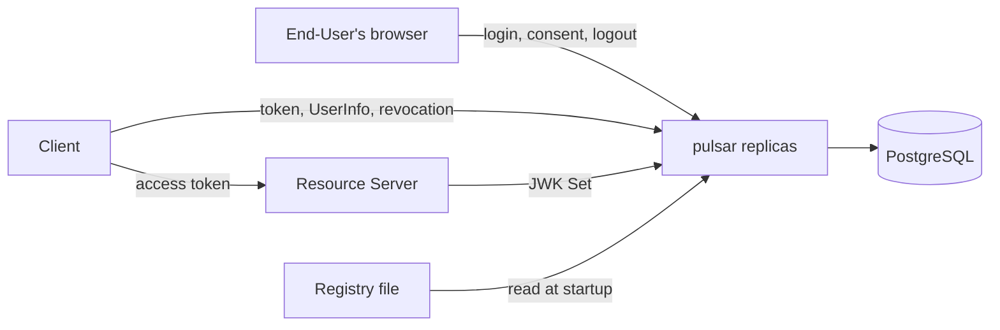

# pulsar

[](https://github.com/palebluedot4/pulsar/actions/workflows/ci.yml?query=branch%3Amain)
[](https://scorecard.dev/viewer/?uri=github.com/palebluedot4/pulsar)

An OpenID Connect Provider in Go, built by AI agents under a harness in
which every control names the evidence behind it. The provider is the
artifact; the method is the subject. Each normative statement it
implements is quoted under an ID, and a test cites the IDs it proves.

> [!IMPORTANT]
> pulsar is a reference implementation, not for production use. The scope
> below is implemented, and development paused on 2026-11-11. Security
> reports are welcome, as [SECURITY.md](SECURITY.md) describes.

## Evidence

- **Conformance.** CI runs four plans of the OpenID conformance suite
  (`release-v5.3.4`) on every pull request and push to `main`. On 2026-11-11, at commit
  `088d7d5` on `main`, all four finished with no unexpected result:
  - Config OP: 1 module passed.
  - Basic OP: 29 of 35 modules passed. One warned, since pulsar never
    returns `acr`; one was skipped, since pulsar supports no request
    objects; four ended in `REVIEW`.
  - Form Post Basic: the same, but that the request-object module, which
    puts `response_mode` only inside the request object, fails its
    form-post checks before it skips.
  - RP-Initiated Logout: 3 of 11 modules passed; eight ended in `REVIEW`.

  `REVIEW` leaves a page for a person to judge, and no person has yet
  reviewed one. Every warning, skip and failure is accepted with its reason
  in [conformance/](conformance/README.md). That is a result of the suite's
  checks, not an OpenID certification.

- **Requirements.** 265 normative statements of 21 specifications have IDs
  in [docs/requirements/](docs/requirements/), each quoting its clause. The
  gate fails on an ID no test cites.
- **Mutation testing** of the security-critical packages, with every mutant
  that lived classed by reading the code:
  [docs/mutation-testing.md](docs/mutation-testing.md).
- **Interoperability.** [examples/](examples/README.md) holds a web app, an
  API, a command-line app and a worker that use `golang.org/x/oauth2`,
  `go-oidc` and `go-jose` against pulsar over the network, in CI.

## Quickstart

With Go, openssl and a PostgreSQL database named `pulsar`:

```sh
# Once per database; every later start needs the same value.
export PULSAR_SECRET="$(openssl rand -base64 32)"
PULSAR_ISSUER=http://localhost:8080 \
  PULSAR_DATABASE_URL='postgres://localhost:5432/pulsar?sslmode=disable' \
  PULSAR_REGISTRY=conformance/registry.json \
  go run ./cmd/pulsar
```

Then, from another shell:

```sh
curl -i localhost:8080/.well-known/openid-configuration
curl -i localhost:8080/jwks
curl -i localhost:8080/readyz
```

`conformance/registry.json` lists only the conformance suite's Clients,
which redirect to the suite. To sign someone in, name a registry of your
own ([configuration.md](docs/configuration.md#the-registry)), or follow
[examples/](examples/README.md#running-them-by-hand).

## What it implements

| Specification                                                                                                  | What pulsar implements                                                                         | Requirements                                                                     |
| -------------------------------------------------------------------------------------------------------------- | ---------------------------------------------------------------------------------------------- | -------------------------------------------------------------------------------- |
| [OpenID Connect Core 1.0](https://openid.net/specs/openid-connect-core-1_0.html)                               | Authorization code flow, ID token, UserInfo, `prompt`, `max_age`, `claims`; no request objects | [core](docs/requirements/openid-connect-core-1.0.md)                             |
| [OpenID Connect Discovery 1.0](https://openid.net/specs/openid-connect-discovery-1_0.html)                     | The discovery document                                                                         | [discovery](docs/requirements/openid-connect-discovery-1.0.md)                   |
| [RP-Initiated Logout 1.0](https://openid.net/specs/openid-connect-rpinitiated-1_0.html)                        | The logout endpoint, with confirmation every time                                              | [logout](docs/requirements/openid-connect-rpinitiated-1.0.md)                    |
| [Form Post Response Mode](https://openid.net/specs/oauth-v2-form-post-response-mode-1_0.html)                  | `response_mode=form_post`                                                                      | [form post](docs/requirements/oauth-v2-form-post-response-mode-1.0.md)           |
| [RFC 6749](https://www.rfc-editor.org/rfc/rfc6749) OAuth 2.0                                                   | Authorization code, refresh token and client credentials grants                                | [rfc6749](docs/requirements/rfc6749.md)                                          |
| [RFC 6750](https://www.rfc-editor.org/rfc/rfc6750) Bearer Token Usage                                          | Bearer tokens at UserInfo, in the header or the body                                           | [rfc6750](docs/requirements/rfc6750.md)                                          |
| [RFC 7009](https://www.rfc-editor.org/rfc/rfc7009) Token Revocation                                            | The revocation endpoint                                                                        | [rfc7009](docs/requirements/rfc7009.md)                                          |
| [RFC 7517](https://www.rfc-editor.org/rfc/rfc7517) JWK, [RFC 7518](https://www.rfc-editor.org/rfc/rfc7518) JWA | The JWK Set; RS256 signing                                                                     | [rfc7517](docs/requirements/rfc7517.md), [rfc7518](docs/requirements/rfc7518.md) |
| [RFC 7521](https://www.rfc-editor.org/rfc/rfc7521), [RFC 7523](https://www.rfc-editor.org/rfc/rfc7523)         | `private_key_jwt` client authentication; no assertion grants                                   | [rfc7521](docs/requirements/rfc7521.md), [rfc7523](docs/requirements/rfc7523.md) |
| [RFC 7591](https://www.rfc-editor.org/rfc/rfc7591) Client Metadata                                             | The registry's Client metadata; no dynamic registration                                        | [rfc7591](docs/requirements/rfc7591.md)                                          |
| [RFC 7636](https://www.rfc-editor.org/rfc/rfc7636) PKCE                                                        | `S256`, required of public Clients                                                             | [rfc7636](docs/requirements/rfc7636.md)                                          |
| [RFC 8252](https://www.rfc-editor.org/rfc/rfc8252) Native Apps                                                 | Any port on a loopback IP redirect URI                                                         | [rfc8252](docs/requirements/rfc8252.md)                                          |
| [RFC 8707](https://www.rfc-editor.org/rfc/rfc8707) Resource Indicators                                         | One `resource` per request, for registered Resource Servers                                    | [rfc8707](docs/requirements/rfc8707.md)                                          |
| [RFC 8725](https://www.rfc-editor.org/rfc/rfc8725) JWT Best Current Practices                                  | Verifying client assertions                                                                    | [rfc8725](docs/requirements/rfc8725.md)                                          |
| [RFC 9068](https://www.rfc-editor.org/rfc/rfc9068) JWT Access Tokens                                           | Access tokens as `at+jwt` JWTs                                                                 | [rfc9068](docs/requirements/rfc9068.md)                                          |
| [RFC 9207](https://www.rfc-editor.org/rfc/rfc9207) Issuer Identification                                       | `iss` in every authorization response                                                          | [rfc9207](docs/requirements/rfc9207.md)                                          |
| [RFC 9700](https://www.rfc-editor.org/rfc/rfc9700) OAuth 2.0 Security BCP                                      | The security baseline                                                                          | [rfc9700](docs/requirements/rfc9700.md)                                          |
| [RFC 10017](https://www.rfc-editor.org/rfc/rfc10017) Browser-Based Apps                                        | Cross-origin requests from public Clients' origins                                             | [rfc10017](docs/requirements/rfc10017.md)                                        |
| [RFC 10070](https://www.rfc-editor.org/rfc/rfc10070) JWT Client Authentication Updates                         | The issuer as a client assertion's sole audience                                               | [rfc10070](docs/requirements/rfc10070.md)                                        |

Deliberately not implemented, each with its reason in
[AGENTS.md](AGENTS.md#deliberately-not-doing): implicit and hybrid flows,
Dynamic Client Registration, Client ID Metadata Documents, introspection,
token exchange, PAR, DPoP, mTLS, Back-Channel and front-channel logout,
session management, and signing algorithms other than RS256. There is no
sign-up, password reset, MFA, social login, SAML or admin UI.

## Documentation

| Document                                       | Contents                                                                          |
| ---------------------------------------------- | --------------------------------------------------------------------------------- |
| [docs/behavior.md](docs/behavior.md)           | What each endpoint does, its error codes, and the lifetimes of what pulsar issues |
| [docs/configuration.md](docs/configuration.md) | The environment variables and the registry of Clients and End-Users               |
| [docs/operations.md](docs/operations.md)       | Starting it, rotating the signing key, making Client secrets, hashing passwords   |
| [docs/adr/](docs/adr/)                         | Decisions, and the options considered                                             |
| [GLOSSARY.md](GLOSSARY.md)                     | The terms these documents use                                                     |
| [conformance/](conformance/README.md)          | How the conformance suite runs, and why each accepted result is accepted          |
| [examples/](examples/README.md)                | The consumers, what their tests prove, and what they do not                       |

## Architecture



Replicas share state only through PostgreSQL
([ADR 0004](docs/adr/0004-postgresql-is-the-only-shared-state.md)), and
read Clients, End-Users and Resource Servers from a static file
([ADR 0001](docs/adr/0001-clients-and-end-users-from-a-static-file.md)).
Resource Servers verify access tokens themselves, against the JWK Set.

## How it was built

[AGENTS.md](AGENTS.md) is the map agents work from.
[docs/harness.md](docs/harness.md) lists every control on them and the
evidence for each, and [docs/research/](docs/research/) holds the dated
surveys the decisions rest on. Since #66, each pull request's description
but Dependabot's records what its three reviews found, fixed and left
unchanged. The one skill written here,
[right-sizing](plugins/right-sizing/README.md), was evaluated before it was
adopted; [its results](plugins/right-sizing/evals/results.md) record what
it changed.

## Verifying it

With Go, Node.js, pnpm, jq and Claude Code installed, and a PostgreSQL
server whose URL, for a role that may create databases, is in
`PULSAR_TEST_DATABASE_URL`:

```sh
make setup        # once per clone: pinned tools, git hooks, Claude Code plugins
make verify       # what CI runs
make conformance  # the conformance suite, with Docker (Compose v2), openssl and jq
make examples     # the examples' tests, with Docker (Compose v2), openssl and Go
```

## About the name

A pulsar's period is its own, and anyone with a radio telescope can check it;
an ID token should be as easy to verify. The
[Pioneer plaques](https://en.wikipedia.org/wiki/Pioneer_plaque) and
Voyager's Golden Record place the Sun among 14 pulsars, and Voyager 1, which
carries that map, took the Pale Blue Dot photograph.

## License

[Apache 2.0](LICENSE).
